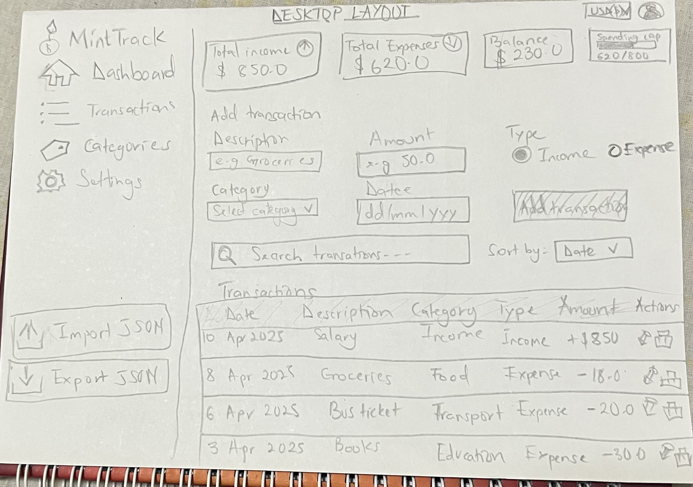

## 1. What is MintTrack?
Minttrack is a simple website that helps students track what they spend. You can add your expenses, such them, and see if you are staying under your budget. Everything is saved in your browser, so you don't need an account.

**Made for:** students who want to control their spending, mostly on their phones.

## 2. Main features

-  Add, edit and delete expenses
-  Search expenses using regex
-  Sort by date, description or amount
-  Dashboard: total spent, total category, last seven days chart and budget
-  Settings: currency (RWF, USD, EUR), budget cap and categories
-  export and import data is a JSON file

## 3. Data model

Each expense is saved like this:

```json
{
  "id": "rec_0001",
  "description": "Lunch at cafeteria",
  "amount": 2500,
  "category": "Food",
  "date": "2026-10-01",
  "createdAt": "2026-10-01T09:11:00.000Z",
  "updatedAt": "2026-10-01T09:11:00.000Z"
}
```
- `id` - a unique number for each expense
- `amount` - always saved in RWF
- `createdAt` / `updatedAt` - when it was added and last changed

## 4. Wirframes




## 5. Accesibility plan

- Use proper HTML tags: `header`, `nav`, `main`, `section`, `footer`.
- A **Skip to main content** link for keyboard users.
- Every input has a **label**, and errors are shown in text, not just colour.
- everything works with the **keyboard only** (Tab, Enter, Escape and `/` to search).
- A clear **focus outline** shows where you are on the page.
- Messages like "Transaction added" and budget warnings are read out by screen readers.
- Good **color contrast** so text is easy to read.
- The layout works on **phone, tablet and computer** (360px, 768px, 1024px).